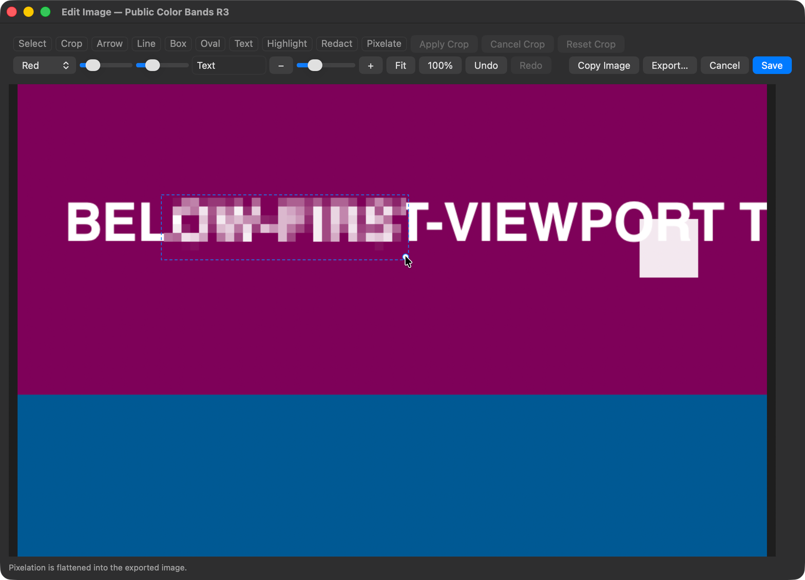
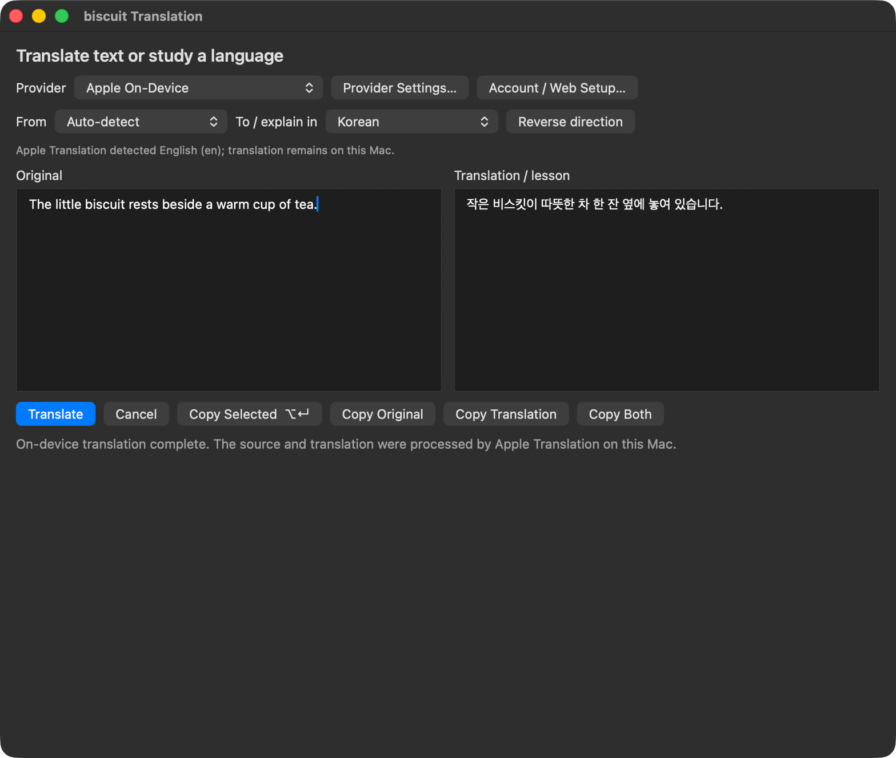
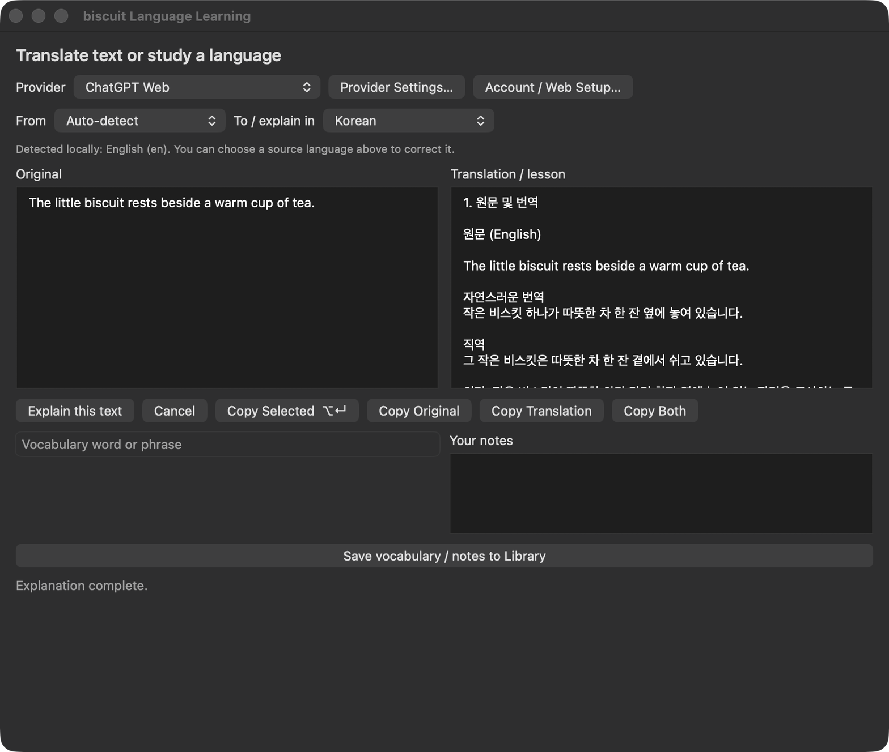

# Biscuit: [cracker.im](https://cracker.im)의 오픈소스 버전입니다. 어쩌면 더 좋을 수도, API를 전혀 쓰지 않을 수도 있습니다.

[English](README.md) | **한국어**

Biscuit은 텍스트와 이미지 캡처, 번역, 언어 학습, 화면 가장자리의 작은 할 일 목록을 제공하는 macOS 메뉴 막대 앱입니다. 로컬 기능은 무료이며, 앱 구독이나 유료 기능 잠금이 없습니다. 텍스트 기록과 이미지 보관은 기본적으로 무제한이고, 이미지 보관 개수는 직접 설정할 수 있습니다.

## 설치

에이전트에게 [이 링크](https://github.com/jsal-afk/biscuit)를 주고 Biscuit을 설치해 달라고 하세요.

### 직접 설치하려면 (정말 원하신다면)

[Releases](https://github.com/jsal-afk/biscuit/releases/latest)에서 macOS 유니버설 앱 압축파일을 다운로드하고, 압축을 푼 뒤 `biscuit.app`을 응용 프로그램 폴더로 옮기세요. 앱을 열고 처음 캡처할 때 화면 기록 권한을 허용하세요. 권한을 허용한 뒤 macOS가 Biscuit을 다시 열도록 안내하면 앱을 다시 실행하세요.

Biscuit은 Apple Silicon과 Intel Mac에서 macOS 14 이상을 지원합니다. Apple 온디바이스 번역은 macOS 15 이상과 지원되는 언어 조합이 필요합니다. 현재 빌드는 Apple 공증 대신 임시 서명(ad-hoc signing)을 사용합니다. 소스에서 빌드하는 방법은 아래에 있습니다.

## 캡처와 편집

화면의 영역을 텍스트나 이미지로 캡처하거나, 겹치는 화면을 이어 붙여 긴 스크롤 이미지를 만들 수 있습니다. OCR은 Apple Vision으로 기기 안에서 처리하며, 표 형태의 텍스트는 스프레드시트에 붙여 넣기 좋은 TSV로 복사할 수 있습니다.

이미지 편집기는 자르기, 화살표, 선, 도형, 텍스트, 강조 표시, 가림 처리, 모자이크를 제공합니다. 원본을 보관하고 편집 내용을 다시 연 뒤 결과를 복사하거나 내보낼 수 있습니다. 화면 모서리의 이미지 선반에서는 마우스를 올려 미리 보거나 파일을 다른 앱으로 드래그할 수 있습니다.



## 번역과 언어 학습

제공자와 언어를 선택한 뒤 **번역** 또는 **설명**을 누르세요. 원문, 결과 또는 둘 다 복사할 수 있습니다. 언어 학습에는 수정 가능한 단어와 메모, 검색 가능한 노트, Markdown 내보내기가 포함됩니다.

- **Apple 온디바이스 번역**은 지원되는 번역을 Mac 안에서 처리합니다. 처음에는 macOS가 언어 팩을 다운로드해야 할 수 있습니다.
- **ChatGPT 구독**은 브라우저 로그인을 지원합니다. Biscuit 자체 세션을 macOS 키체인에 저장하고 앱을 다시 실행해도 재사용합니다. 기존 Codex 세션을 연결할 수도 있으며, 이 별도 연결의 갱신은 Codex가 관리합니다.
- **ChatGPT Web**은 Codex 사용량이나 API 키 종량제 과금 대신 ChatGPT 채팅 사용 한도를 사용합니다. 이용 중인 요금제와 모델의 한도는 그대로 적용됩니다. 사용자 확인 후 별도의 Electron 런타임을 다운로드하고 검증하며, 독립된 브라우저 프로필을 유지합니다.
- **Claude**는 별도의 네이티브 계정 및 제공자 설정을 갖추고 있습니다.

로컬 캡처, OCR, 기록, 편집, 할 일은 AI 계정 없이 사용할 수 있습니다. 제공자 이용 가능 여부는 계정과 서비스에서 제공하는 모델에 따라 달라집니다. Biscuit은 임의로 제공자를 바꾸거나 유료 API 키로 자동 전환하지 않습니다.





## 기록 다시 찾기

기록에서 텍스트와 이미지 OCR 내용을 검색하고, 이전 결과를 다시 복사하거나 항목 하나 또는 전체 라이브러리를 내보낼 수 있습니다. 이미지 보관의 기본값은 **모두 보관**입니다. 보관 한도를 줄이면 기존에 관리하던 오래된 이미지를 삭제하기 전에 확인을 요청합니다.

할 일 목록은 단축키를 누르거나 마우스 포인터를 화면 오른쪽 가장자리에 잠시 두면 나타납니다. 날짜를 추가하고, 중요한 항목에 별표를 붙이고, 필요할 때 패널을 다른 창 위에 고정할 수 있습니다.

## 단축키와 설정

| 기본 단축키 | 동작 |
| --- | --- |
| Option-C | 텍스트 캡처 |
| Option-T | 번역용 캡처 |
| Option-L | 언어 학습용 캡처 |
| Option-D | 할 일 표시 또는 숨기기 |
| Option-S | 스크롤 이미지 캡처 |
| Command-Shift-4 | 이미지 캡처 |

모든 동작은 메뉴 막대에서도 사용할 수 있으며, 단축키는 설정에서 변경할 수 있습니다. Command-Shift-4는 macOS 스크린샷 단축키와 충돌할 수 있으므로 필요하면 다른 조합을 선택하세요. 설정에는 OCR 옵션, 28개 인터페이스 언어, 이미지 선반 동작, 선택적 업데이트 확인도 포함됩니다. 자동 업데이트 확인은 기본적으로 꺼져 있습니다.

## 개인정보

기록, 이미지, 할 일, 학습 노트는 `~/Library/Application Support/biscuit/`에 로컬로 저장됩니다. OCR은 Mac 안에서 처리됩니다. 번역과 학습은 사용자가 제출한 텍스트를 선택한 제공자에게 전송합니다. 선택 기능인 AI 이미지 제목은 기본적으로 꺼져 있으며, 이미지 자체가 아닌 인식된 텍스트를 전송합니다. ChatGPT Web 프로필은 개인 브라우저와 분리되고 라이브러리 내보내기에서 제외됩니다. Biscuit에는 분석용 추적이나 백그라운드 클립보드 수집 기능이 없습니다.

## 소스에서 빌드

Apple Command Line Tools를 설치하고, ChatGPT Web 빌드용 Bun 1.4.0을 준비하세요. 네이티브 앱은 Swift, AppKit, macOS 프레임워크를 사용합니다. 빌드된 앱을 실행하는 데 Bun, Node, Python이나 개발 에이전트는 필요하지 않습니다.

```sh
./scripts/build.sh
open build/biscuit.app
```

빌드 결과는 arm64/x86_64 유니버설 앱입니다. Bun이 PATH에 없다면 `BUN_EXECUTABLE`을 설정하세요. 현재 빌드는 macOS 26 SDK와 Swift 6.2 툴체인을 사용합니다.

## 감사의 말과 라이선스

ChatGPT Web 통합의 기반이 된 [miuuyy/codex-chatgpt-web](https://github.com/miuuyy/codex-chatgpt-web)에 감사드립니다.

Biscuit 자체 코드는 [MIT 라이선스](LICENSE)를 따릅니다. 일부 OpenAI OAuth 코드는 Apache-2.0 라이선스의 [OpenAI Codex](https://github.com/openai/codex)를 바탕으로 적용했으며, 해당 [라이선스](Resources/Notices/OpenAICodex/LICENSE), [고지](Resources/Notices/OpenAICodex/NOTICE), [원본 커밋 정보](Resources/Notices/OpenAICodex/SOURCE-PIN.txt)를 포함합니다. 선택적으로 사용하는 Electron 런타임에는 별도의 라이선스가 적용됩니다.
