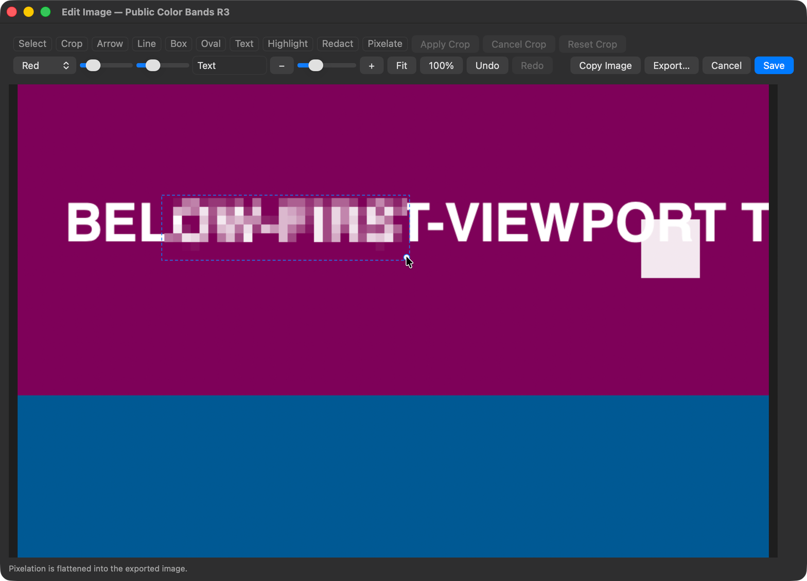
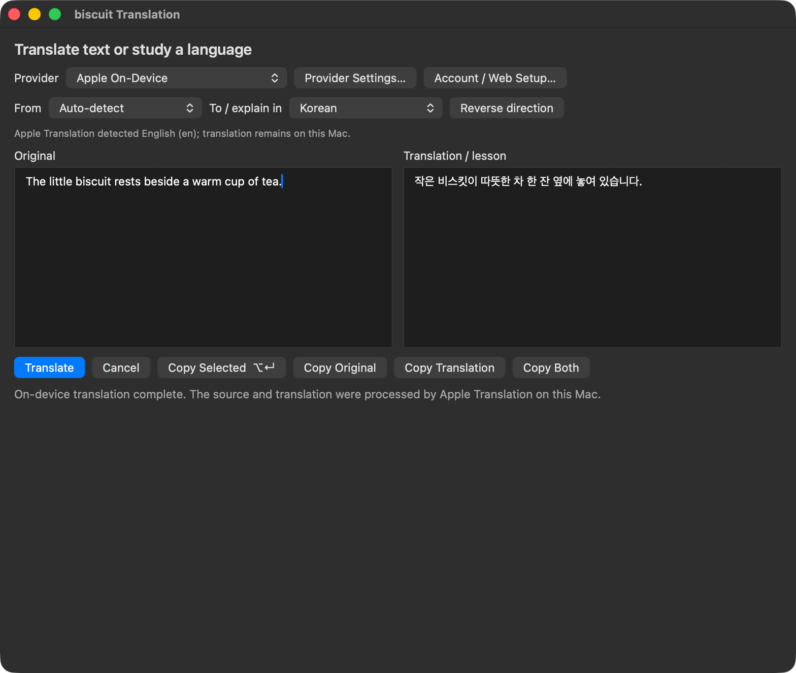
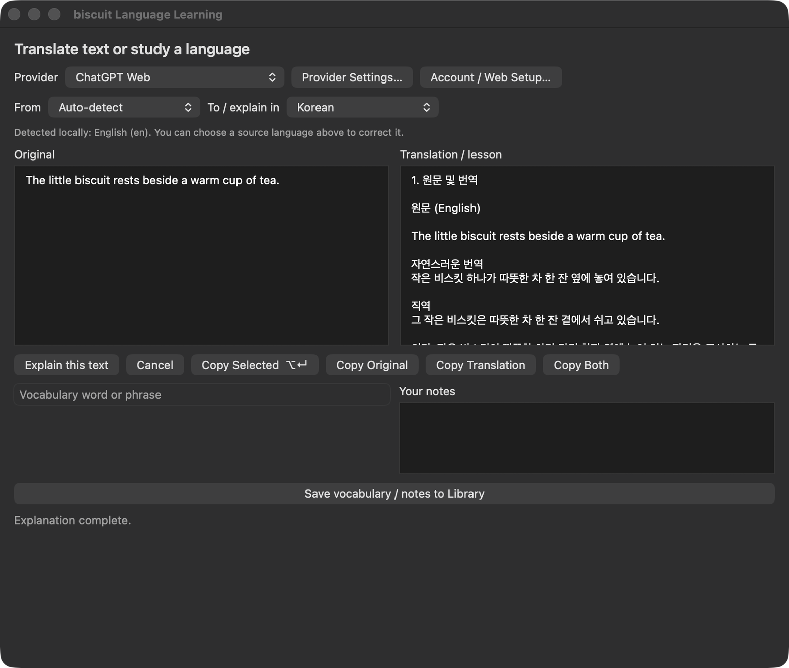

# Biscuit: It's just an open-source version of [cracker.im](https://cracker.im). Or even better. Or maybe with no API usage at all.

**English** | [한국어](README.ko.md)

Biscuit is a macOS menu-bar app for capturing text and images, translating, studying languages, and keeping a small to-do list at the edge of your screen. Local features are free, with no app subscription or paid feature lock. Text history and image retention are unlimited by default; you can set an image limit yourself.

## Install

Ask your agent to install Biscuit with [this link](https://github.com/jsal-afk/biscuit).

### For a manual installation (If you really want to)

Download the macOS universal app archive from [Releases](https://github.com/jsal-afk/biscuit/releases/latest), unzip it, and move `biscuit.app` to Applications. Open the app and allow screen recording when you first use capture. If macOS asks you to reopen Biscuit after granting permission, do so.

Biscuit supports macOS 14 or later on Apple Silicon and Intel. Apple On-Device Translation requires macOS 15 or later and a supported language pair. Current builds are ad-hoc signed rather than Apple-notarized; source build instructions are below.

## Capture and edit

Capture an area as text or an image, or stitch overlapping views into a long scrolling capture. OCR runs locally with Apple Vision, and table-shaped text can be copied as spreadsheet-ready TSV.

The image editor includes crop, arrows, lines, shapes, text, highlights, redaction, and pixelation. Keep the original, reopen an edit, then copy or export the result. The corner image shelf supports hover preview and dragging a file into another app.



## Translate and study

Choose a provider and languages, then press **Translate** or **Explain**. You can copy the original, the result, or both. Language study includes editable vocabulary and notes, a searchable notebook, and Markdown export.

- **Apple On-Device Translation** processes supported translations on your Mac. macOS may need to download a language pack first.
- **ChatGPT subscription** supports browser sign-in with Biscuit’s own session stored in macOS Keychain and reused after restarting the app. You can also connect an existing Codex session; Codex manages renewal for that separate connection.
- **ChatGPT Web** uses your ChatGPT chat allowance rather than Codex quota or metered API-key billing. Your plan and model limits still apply. With your confirmation, Biscuit downloads and verifies a separate Electron runtime and keeps its own browser profile.
- **Claude** has separate native account and provider settings.

Local capture, OCR, history, editing, and todos work without an AI account. Provider access depends on your account and the service's available models. Biscuit does not silently switch providers or fall back to a paid API key.





## Find it again

Search text and image OCR in History, re-copy an earlier result, or export one item or the whole library. Image retention defaults to **Keep all**. Applying a smaller limit asks before deleting older managed images.

Todos appear with a shortcut or when you rest the pointer at the right screen edge. Add dates, star important items, and keep the panel on top when you need it.

## Shortcuts and settings

| Default shortcut | Action |
| --- | --- |
| Option-C | Capture text |
| Option-T | Capture for translation |
| Option-L | Capture for language study |
| Option-D | Show or hide todos |
| Option-S | Scrolling image capture |
| Command-Shift-4 | Image capture |

All actions are available from the menu bar, and shortcuts can be changed in Settings. Command-Shift-4 may conflict with macOS Screenshot; choose another shortcut if needed. Settings also include OCR options, 28 interface languages, image-shelf behavior, and optional update checks. Automatic update checks are off by default.

## Privacy

History, images, todos, and study notes are stored locally in `~/Library/Application Support/biscuit/`. OCR stays on the Mac. Translation and study send the text you submit to your selected provider. Optional AI image titles are off by default and send recognized text, not image bytes. The ChatGPT Web profile is separate from your personal browser and is excluded from library exports. Biscuit has no analytics or background clipboard collection.

## Build from source

Install Apple's Command Line Tools and supply Bun 1.4.0 for the ChatGPT Web build. The native app uses Swift, AppKit, and macOS frameworks; users do not need Bun, Node, Python, or a development agent to run the built app.

```sh
./scripts/build.sh
open build/biscuit.app
```

The build produces a universal arm64/x86_64 app. Set `BUN_EXECUTABLE` if Bun is not on your path. The current build uses the macOS 26 SDK and Swift 6.2 toolchain.

## Credits and license

Thanks to [miuuyy/codex-chatgpt-web](https://github.com/miuuyy/codex-chatgpt-web) for the ChatGPT Web integration.

Original Biscuit code is [MIT-licensed](LICENSE). Selected OpenAI OAuth code is adapted from [OpenAI Codex](https://github.com/openai/codex) under Apache-2.0; its [license](Resources/Notices/OpenAICodex/LICENSE), [notice](Resources/Notices/OpenAICodex/NOTICE), and [source pin](Resources/Notices/OpenAICodex/SOURCE-PIN.txt) are included. The optional Electron runtime carries its own licenses.
